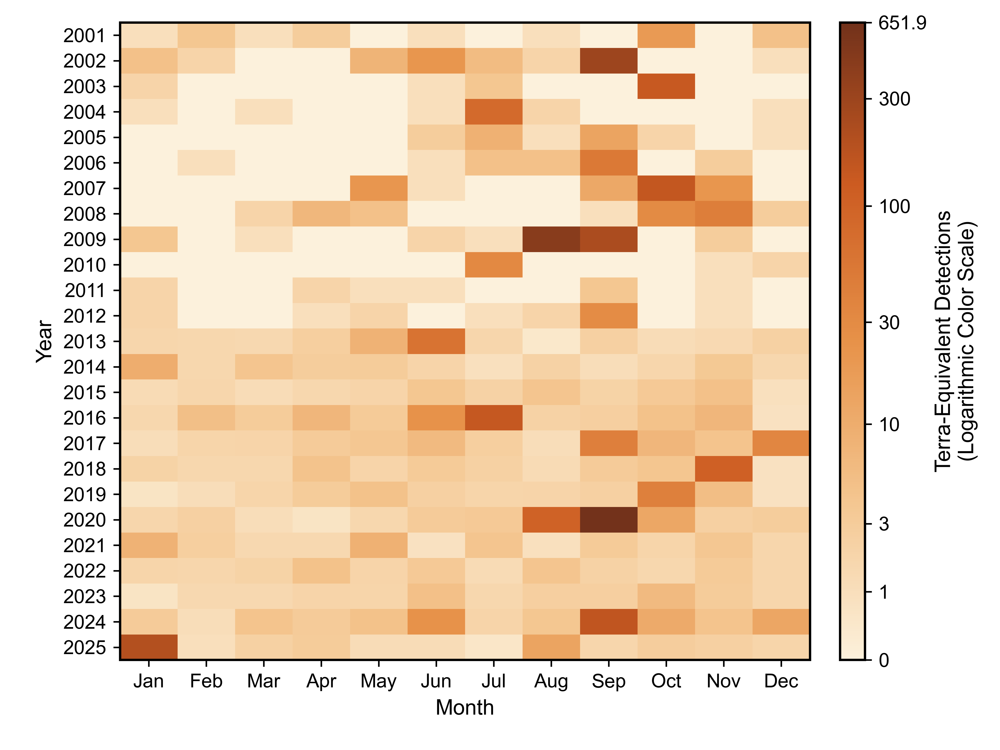
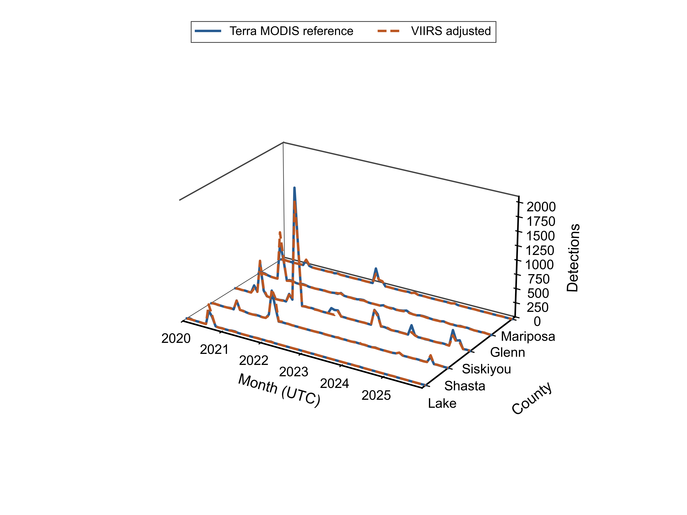

# FlareFront

**Harmonizing MODIS and VIIRS hotspot records across four California counties, with historical calendars, mapped observations and reproducible method comparisons.**

2001–2025 · 300 months per county · 46,473 qualifying observations · 39 source archives

## A longer view of reported fire activity

Explore a year-by-month calendar, select a month to inspect its county map and weekly totals, and compare the unadjusted Terra MODIS, Aqua MODIS, and Suomi-NPP VIIRS records. Date and source filters follow through to CSV downloads; chart controls export PNG and SVG figures. The static application bundles its data and browser libraries, with no API key or Python backend.

The website has two views: **Fire Calendar** and **Compare Locations**. The calendar opens with observed Terra counts, raw VIIRS counts and scaled VIIRS counts, followed by the calendar and map. Methods, sources and downloads expand on demand. Compare Locations provides a rotatable 3D view of month, county and detection count, plus a 2D agreement plot and an error table. Switch between raw counts, count ratio calibration and spatial aggregation. The county-wide records retain their original data and independent coefficients.

**Explore a local area:** choose a county, then select **Draw Area** and click or tap two opposite corners on the map. Alternatively, open **Enter Coordinates**, enter WGS 84 latitude and longitude plus a radius of 0.1–100 km, and apply. The center must be inside the selected county. All results use the intersection with that county; observations outside the four processed counties are unavailable. **Clear Area** restores the county record; **County Extent** changes only the map viewport. Escape cancels drawing.

Area selections update the calendar, mapped observations, daily, weekly and annual totals, historical comparisons and CSV downloads together. Custom areas show **raw Terra, Aqua and Suomi-NPP counts only**: county coefficients and validation results do not transfer to arbitrary areas. CSVs retain source provenance and add county GEOID, area definition and calibration scope. Empty source periods remain unavailable; available periods without matching observations show zero. Circle filtering uses great-circle distance on a sphere with radius 6,371,008.8 m; rectangles include their boundary. Coordinate entry also supports keyboard use. These historical records support research, land management and responder planning; the site is not a live warning or dispatch service.

**Historical comparisons:** each month shows its arithmetic mean across the same month in other eligible years and an anomaly (selected value minus that mean). The reference uses the full record for the selected county or area and sensor, independent of date filters. Missing values and explicitly incomplete first months of the active source are excluded; observed zeros remain included. Comparisons for a selected incomplete first month are withheld. Percentage anomalies are undefined when the mean is zero. CSV downloads include the mean, included baseline years, signed anomaly and percentage, alongside the earlier median fields.

The **Values And Anomalies** view provides a numeric alternative to the heatmap, with keyboard-selectable months. **Daily Activity And Trends** includes a day-by-day fire activity calendar with exact raw sensor counts, plus weekly totals. The sequential fire palette decreases in luminance as counts rise; daily cells choose black or white text to meet at least 4.5:1 contrast. Missing cells use a dash and explicit accessible labels. Counts represent satellite hotspot detections, not a verified count of distinct fires; dates with detections are not observing-coverage days.

**Long-Term Patterns** compares monthly means and medians, annual totals with trailing five-year averages, and two years' twelve-month profiles. It uses one raw sensor at a time across the full record: Terra from 2001, Aqua from 2003, or Suomi-NPP from 2013. Only years with twelve available, non-partial monthly values qualify. Observed zeros stay included; missing years break the five-year moving average. Complete records do not establish complete observing coverage. County and custom-area selections both apply; calendar date filters and the harmonized series selector do not change this separate analysis.

The year comparison reports Pearson correlation of monthly counts and [Spearman correlation](https://www.itl.nist.gov/div898/software/dataplot/refman2/ch2/rankcorr.pdf) of their ranks, using average ranks for ties. Constant profiles and self-comparisons have undefined correlations. The all-years summary takes the median Spearman coefficient across unique eligible year pairs; these pairs share years and are not independent replicates. Chart values and all pairwise coefficients are downloadable as CSV with sensor and area metadata. Charts export in the approved 7.16 × 3.58 in format, as 600 dpi PNG and vector SVG.

Terra's 2001–2025 record illustrates why averages and recurrence need separate interpretation:

| County | Highest Monthly Mean | Mean Detections | Median For That Month | Median Year-Pair Spearman ρ |
| --- | --- | ---: | ---: | ---: |
| Los Angeles | September | 63.64 | 2 | 0.058 |
| San Diego | October | 77.32 | 0 | 0.042 |
| Santa Clara | August | 25.72 | 0 | −0.091 |
| Sacramento | October | 2.56 | 2 | 0.182 |

Each correlation summary contains 300 year pairs. The large mean–median differences show the influence of extreme months, while the near-zero median correlations do not support a consistently repeated annual profile. These are descriptive hotspot statistics, not a fitted climate trend or demonstrated forecasting skill. Computation lives in [patterns.js](web/patterns.js); numerical tests check the four counties against independent Python/SciPy calculations.

| City | County Coverage | Qualifying Observations | Adjusted MAE | Seasonal MAE | Held-Out Criterion |
| --- | --- | ---: | ---: | ---: | --- |
| Los Angeles | Los Angeles | 26,113 | 4.924891 | 18.513889 | Passed |
| San Diego | San Diego | 10,529 | 2.064945 | 2.555556 | Passed |
| San Jose | Santa Clara | 7,021 | 0.999082 | 8.666667 | Passed |
| Sacramento | Sacramento | 2,810 | 1.619257 | 1.583333 | **Did Not Pass** |

The criterion requires lower monthly MAE against Terra than both unscaled VIIRS and the training seasonal baseline on 2020–2025. Sacramento's adjusted record is explicitly experimental. Additional cities require their own boundary filtering, local fit and held-out evaluation. A county's result does not transfer to another location.



<table>
<tr>
<td width="50%"><br><sub>January 2025, split into Monday-start UTC weeks.</sub></td>
<td width="50%"><br><sub>Unadjusted sensor records; first sensor years may be partial.</sub></td>
</tr>
</table>

Calendar colors use log(1 + count), with the full-record range fixed for each series. Colorbar ticks, hover values, and CSV downloads retain detection counts; no values are clipped.

## Los Angeles calibration results

Terra MODIS supplies the reference counts. The main calendar uses Terra through 2012, then **α × Suomi-NPP** from 2013. The coefficient is fitted only on 2013–2019 totals: **α = 676 / 5,973 = 0.1131759585**. Evaluation uses all 72 months in the held-out 2020–2025 period.

| Series compared against Terra | Monthly mean absolute error |
| --- | ---: |
| **Adjusted Suomi-NPP** | **4.924891** |
| Unscaled Suomi-NPP | 147.805556 |
| Training-period seasonal median | 18.513889 |

The adjusted series passes the predefined aggregate criterion: lower MAE than both baselines on identical evaluation months. It does **not** improve on the seasonal baseline in every year: adjusted MAE is 2.364167 versus 1.166667 in 2022, and 2.009013 versus 1.500000 in 2023. Annual and processing-period comparisons remain visible in the dashboard.

## Spatial Harmonization Comparison

The spatial experiment groups VIIRS points into acquisition groups, counts occupied nominal 1 km grid cells, averages four fixed grid origins, and calibrates monthly occupancy to Terra. It also compares zero-intercept absolute-error fits against the total-ratio fit. This changes the spatial-density feature; it does not recreate MODIS pixels or synchronize satellite overpasses.

| County | Count Ratio MAE | Spatial Ratio MAE | Difference |
| --- | ---: | ---: | ---: |
| Los Angeles | 4.924891 | 7.576510 | Higher error |
| San Diego | 2.064945 | 1.993049 | Lower error |
| Santa Clara | 0.999082 | 4.216862 | Higher error |
| Sacramento | 1.619257 | 1.618393 | Lower error |

All rows use the same 72 months in 2020-2025. **No new candidate qualifies to replace the original ratio in any county.** Selection uses only forward validation within 2013-2019 and requires more than 5% lower pooled MAE with no more than 10% higher top-five peak-month MAE. Small later-period gains cannot override that rule. These archive years had already been inspected; this is an exploratory comparison, not independent confirmation.

The [protocol](analysis/spatial_harmonization_protocol.json) fixes the spherical equal-area grid, four origins, 20-minute adjacent acquisition-gap rule, candidate list and selection thresholds. The [complete result](web/data/harmonization-study.json) includes every candidate, source hashes, coefficients, validation folds, monthly values, yearly metrics, bias and peak errors. Raw observations are preserved.

```sh
python -B -m analysis.build_spatial_harmonization --output web/data/harmonization-study.json
python -B -m analysis.harmonization_figures --output-dir web/figures
python -B -m unittest tests.test_spatial_harmonization
```

VIIRS has finer spatial sampling and greater response to small fires than MODIS. Spatially combining positive detections cannot reproduce the original radiance-based classification, recover cloud masks, or establish observation opportunities. See the [NASA VIIRS product description](https://firms.modaps.eosdis.nasa.gov/content/descriptions/FIRMS_VIIRS_Firehotspots.html) and [Schroeder et al. (2014)](https://doi.org/10.1016/j.rse.2013.12.008). Agreement with Terra is sensor-count agreement, not the true number of fires, burned area or forecasting accuracy.



Figure downloads follow the selected method and view. The 3D exports use a fixed camera and a 7.16 × 5.37 in canvas; 2D agreement plots use 7.16 × 3.58 in. Each figure has a 600 dpi PNG and a vector SVG, with Arial Regular and no embedded raster layers in the SVG.

## Interpret the record carefully

- These are **hotspot detections, not individual fires**, burned area, severity, forecasts, or emergency guidance. Multiple satellite reports can relate to one fire; fractional Terra-equivalent values are estimates.
- Zero means no qualifying detections were reported. Missing source periods remain unavailable. Point records do not establish observation coverage, cloud-free conditions, or absence of fire.
- The record is not verified as uniform Collection 6.1. Supplied MODIS labels `6.2`, `6.03`, and `61.03`, and VIIRS CSV version `2`, are preserved. A single ratio does not model all seasonal, diurnal, coverage, or processing differences.
- Aqua July 2002 and Suomi-NPP January 2012 are partial first months. Historical medians use the same month in all other available years, excluding the selected year; they are retrospective references.

Qualifying records fall inside or on the full Census 2026 county MultiPolygon, including offshore components, have type 0, and meet MODIS confidence ≥ 30 or VIIRS nominal/high confidence. Exact location/date/time/satellite duplicates are removed; distinct overpasses remain separate. All dates and aggregation use UTC.

## Run locally

Requires **Node.js 22+**. Data and browser dependencies are bundled; no package installation is required.

```sh
npm run build
npm start
```

Open the local address printed by the server. The build output is `dist/`.

For Cloudflare Pages, connect this GitHub repository, select the `main` branch, set the build command to `npm run build`, and set the output directory to `dist`. Set `NODE_VERSION=22` and `SKIP_DEPENDENCY_INSTALL=true` in the build environment; the static build requires no dependency installation. The project uses [flarefront.pages.dev](https://flarefront.pages.dev); local changes appear there only after a successful GitHub-triggered deployment.

Static asset requests are [free and unlimited](https://developers.cloudflare.com/pages/functions/pricing/); the Free plan allows [500 builds per month](https://developers.cloudflare.com/pages/platform/limits/). This application has no Pages Functions. Scientific data are bundled. The geographic background loads visible map tiles from OpenStreetMap, a separate best-effort service governed by its [tile usage policy](https://operations.osmfoundation.org/policies/tiles/). If tiles fail, the county outline and hotspot data remain available. No offline tile download or prefetch is provided.

## Reproduce the analysis

Python is used for offline preprocessing, validation, and reference figures. Requires **Python 3.12+**, the pinned dependencies in [requirements.txt](requirements.txt), and the original NASA FIRMS annual ZIPs: `modis_2001_all_countries.zip` through `modis_2025_all_countries.zip`, plus `viirs-snpp_2012_all_countries.zip` through `viirs-snpp_2025_all_countries.zip`. Only each archive's `United_States` CSV member is read; originals are unchanged.

Windows PowerShell:

```powershell
python -m venv .venv
.venv\Scripts\python -m pip install -r requirements.txt
.venv\Scripts\python analysis/stage_firms.py --source-dir PATH_TO_ARCHIVES --sensor modis --start-year 2001 --end-year 2025 --output-dir build-data
.venv\Scripts\python analysis/stage_firms.py --source-dir PATH_TO_ARCHIVES --sensor viirs-snpp --start-year 2012 --end-year 2025 --output-dir build-data
Copy-Item web/data/county.geojson build-data/los_angeles_county_2026.geojson
.venv\Scripts\python analysis/build_data.py --input-dir build-data --output-dir web/data
npm run build
```

Replace `PATH_TO_ARCHIVES` with the folder containing those ZIPs. On macOS/Linux, use `.venv/bin/python` and `cp`. Filter definitions live in [analysis/config.json](analysis/config.json); the dashboard data preserves source-member names, CRC32 values, version counts, exclusion accounting, and computed metrics.

Rebuild the three additional counties using the bundled Census 2026 boundaries. The script streams each original USA archive member once across their envelopes, fits each county independently and preserves existing Los Angeles outputs:

```sh
python analysis/build_regions.py --source-dir PATH_TO_ARCHIVES --boundary-root web/data/regions --staging-root build-data/regions --output-root web/data
npm run build
```

The registry in [analysis/regions.json](analysis/regions.json) maps cities to counties and generates the runtime selector. A zero training total leaves calibration unestimable and adjusted values unavailable; raw sensor counts remain accessible. The original reference PNG/SVG files are Los Angeles examples; interactive figure and CSV exports use the selected county.

### Calibration Benchmarks

The [benchmark protocol](analysis/harmonization_protocol.json) compares the existing ratio with eight alternatives: a recent-training-window ratio, two quarterly adjustments, two solar-day/night adjustments and three regularized Poisson count models. Selection uses expanding training windows ending before each validation year from 2016 through 2019. A replacement must reduce pooled validation MAE by more than 5% without increasing the top-five peak-month MAE by more than 10%; these are engineering selection thresholds, not significance tests. The previously inspected 2020–2025 record is an exploratory benchmark, not an untouched confirmation set.

```sh
python analysis/benchmark_harmonization.py --output-dir build-data/harmonization-benchmark
python -m unittest tests.test_harmonization_benchmark
```

The command reads bundled county records and writes `report.json`, `summary.csv` and `predictions.csv` outside runtime data. Outputs include every candidate, failed fits, source hashes, fitted parameters, validation folds, monthly errors, bias and peak diagnostics. Solar time is approximated from acquisition time and longitude; it does not establish illumination quality or simultaneous observations. Poisson models estimate conditional mean counts and provide no probabilistic uncertainty claim for these overdispersed data.

On the bundled record, training-only selection retains the original ratio in San Diego, Santa Clara and Sacramento. It selects a solar-period adjustment in Los Angeles, whose later-period MAE increases from 4.924891 to 5.142033. These experiments therefore do not replace the website calibration. Selecting a different candidate because it looks best on the already-inspected benchmark would require a new independent evaluation.

```powershell
npm test
.venv\Scripts\python -B -m unittest discover -s tests -p test_analysis.py -v
.venv\Scripts\python analysis/figures.py --data web/data/dashboard.json --output-dir web/figures
```

Set `FLAREFRONT_INPUT_DIR` to the staging directory for the real-data acceptance case outside the original workspace. Reference figures are exported as matching 600 dpi PNG and vector SVG files; Arial Regular is required.

Earlier prediction, allocation and weather/spectral experiments remain in the repository with their source data and tests. They are excluded from the website build. Their outputs do not establish improved forecasting or firefighting outcomes.

## Sources and license

[NASA FIRMS](https://firms.modaps.eosdis.nasa.gov/country/) supplies the MODIS and Suomi-NPP observations. The county geometry comes from [U.S. Census TIGERweb](https://tigerweb.geo.census.gov/arcgis/rest/services/TIGERweb/State_County/MapServer), using the same 2026 boundary for every year.

Background map data is © [OpenStreetMap contributors](https://www.openstreetmap.org/copyright). Separate archived research inputs retain their original NWS and NASA EMIT provenance in their data files.

Original application and analysis code is licensed under [Apache-2.0](LICENSE). See [NOTICE](NOTICE) and [THIRD_PARTY_NOTICES](THIRD_PARTY_NOTICES) for attribution and third-party terms.

AI assisted code editor was used for development of this website
