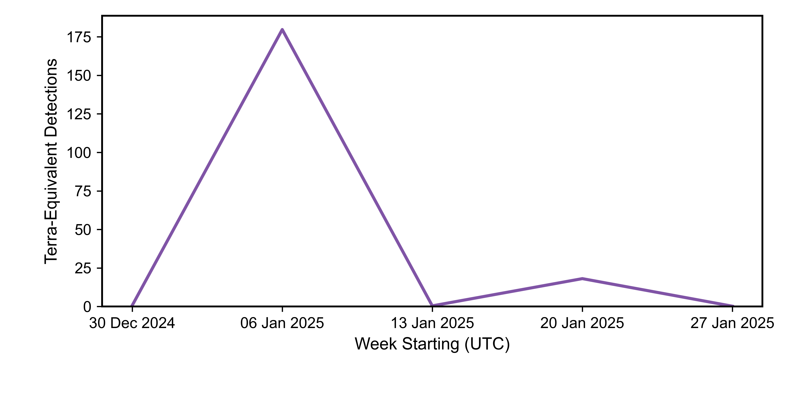

# FlareFront

**Harmonizing MODIS and VIIRS hotspot records across four California county regions, with historical calendars, mapped observations, multimodal evidence and an evaluated location-and-time prediction exercise.**

2001–2025 · 300 months per county · 46,473 qualifying observations · 39 source archives

## A longer view of reported fire activity

Explore a year-by-month calendar, select a month to inspect its county map and weekly totals, and compare the unadjusted Terra MODIS, Aqua MODIS, and Suomi-NPP VIIRS records. Date and source filters follow through to CSV downloads; chart controls export PNG and SVG figures. The static application bundles its data and browser libraries, with no API key or Python backend.

The website has two views: **Explore Fire Records** and **Test A Prediction**. The record opens with observed Terra counts, raw VIIRS counts and scaled VIIRS counts, followed by the calendar and map. Calibration details, monthly trends, methods and downloads expand on demand. The prediction view opens directly onto the map and area/week controls, followed by a short conclusion. Full benchmark results and weather/spectral research remain in separate expandable sections. The four city choices use complete county boundaries; each county retains its own coefficient and evaluation.

| City | County Coverage | Qualifying Observations | Adjusted MAE | Seasonal MAE | Held-Out Criterion |
| --- | --- | ---: | ---: | ---: | --- |
| Los Angeles | Los Angeles | 26,113 | 4.924891 | 18.513889 | Passed |
| San Diego | San Diego | 10,529 | 2.064945 | 2.555556 | Passed |
| San Jose | Santa Clara | 7,021 | 0.999082 | 8.666667 | Passed |
| Sacramento | Sacramento | 2,810 | 1.619257 | 1.583333 | **Did Not Pass** |

The criterion requires lower monthly MAE against Terra than both unscaled VIIRS and the training seasonal baseline on 2020–2025. Sacramento's adjusted record is explicitly experimental. Additional cities require their own boundary filtering, local fit and held-out evaluation. A county's result does not transfer to another location.


<table>
<tr>
<td width="50%"><br><sub>January 2025, split into Monday-start UTC weeks.</sub></td>
<td width="50%"><br><sub>Unadjusted sensor records; first sensor years may be partial.</sub></td>
</tr>
</table>

Calendar colors use log(1 + count), with the full-record range fixed for each series. Colorbar ticks, hover values, and CSV downloads retain detection counts; no values are clipped.

## Los Angeles calibration results

Terra MODIS supplies the reference counts. The main calendar uses Terra through 2012, then **α × Suomi-NPP** from 2013. The coefficient is fitted only on 2013–2019 totals: **α = 676 / 5,973 = 0.1131759585**. Evaluation uses all 72 months in the held-out 2020–2025 period.

| Series compared against Terra | Monthly mean absolute error |
| --- | ---: |
| **Adjusted Suomi-NPP** | **4.924891** |
| Unscaled Suomi-NPP | 147.805556 |
| Training-period seasonal median | 18.513889 |

The adjusted series passes the predefined aggregate criterion: lower MAE than both baselines on identical evaluation months. It does **not** improve on the seasonal baseline in every year: adjusted MAE is 2.364167 versus 1.166667 in 2022, and 2.009013 versus 1.500000 in 2023. Annual and processing-period comparisons remain visible in the dashboard.

## Location and time predictions

The research matrix compares the evidence needed for weather-only, weather-plus-harmonized-history, and weather-plus-history-plus-hyperspectral prediction. The Santa Clarita evidence study uses an editable June 2024 cutoff. Its measurements remain separate from the satellite-only location/week evaluation.

- Hotspot context filters actual acquisitions before an editable UTC cutoff, keeping sensor counts separate. Applying the county calibration within the smaller study envelope is exploratory and has not been independently validated.
- The saved NWS forecast and Saugus observation are dated November 15, 2026. They are excluded from the 2024 comparison. Missing observation temperature and humidity remain unavailable.
- NASA EMIT Version 001 reflectance and quality masks from April 23, 2024 yield Gao NDWI using the 857.594 and 1238.060 nm bands. Only 1,368 of 679,173 sampled native pixels in the study envelope pass screening (0.20%); their median index is −0.0369. These are pixel statistics, not area-weighted estimates or a vegetation classification. Sparse support cannot establish regional fuel condition or prediction improvement.
- The same scene also supplies NDVI, MSI, PSRI and PRI. Screening retains 1,368 pixels for NDWI, NDVI, MSI and PRI, and 1,337 for PSRI. These are correlated features from one sensor, not five independent modalities. Formulas, sources, actual band centers, band widths and quality counts are retained in the downloadable summary. Nearest-band guards of 10 nm for NDWI and 5 nm for the other indices are engineering tolerances, not independently validated physical equivalence.
- Measured spectral input is displayed only after both acquisition and source-product creation timestamps precede the cutoff. These timestamps do not establish when the product was publicly available or operationally usable. The April scene is about 54 days old at the default June cutoff.


The prediction exercise asks visitors to choose one county-clipped 0.2-degree area and one UTC week within a 28-day window, then lock that choice and reveal actual qualifying Suomi-NPP detections. Each model has the same one-area/one-week budget. Location-only and week-only matches are diagnostic; both must match for a hit. Revealed cases are labeled as practice when revisited. This static site bundles outcomes and is not a blinded experiment.

The [fixed protocol](analysis/prediction_protocol.json) evaluates all 26 complete, non-overlapping windows from January 2024 through December 28, 2025 in each of four counties (104 windows total). Quiet windows remain in the denominator; the final three days are excluded. Seasonal rates use only 2013-2019. Recent counts use the preceding 28 days with a two-day acquisition embargo. Reprocessed archives do not establish operational publication times. The rule weights and grid were fixed before computing this exploratory comparison; these archive years had already been inspected for the calendar.

| County Record | Seasonal | Recent VIIRS | History + Recent VIIRS | History + MODIS / VIIRS |
| --- | ---: | ---: | ---: | ---: |
| Los Angeles | 3/26 | 10/26 | 5/26 | 3/26 |
| San Diego | 0/26 | 6/26 | 5/26 | 5/26 |
| San Jose / Santa Clara | 1/26 | 3/26 | 3/26 | 3/26 |
| Sacramento | 6/26 | 6/26 | 7/26 | 8/26 |

These are exact location-and-week matches, not ignition forecasts or firefighting outcomes. The combined rule provides no consistent advantage. Recent VIIRS alone has 25 matches across 104 windows; the combined rule has 19. Adding Terra to the history-plus-recent rule increases matches in Sacramento, leaves two counties unchanged, and reduces Los Angeles matches. No uncertainty or significance claim is made.

Seasonal scores sum 2013-2019 cell/month detection rates over each candidate future week. Recent VIIRS scores use input-window counts and cannot distinguish the four future weeks; ties select the earliest. The two combined rules equally weight separately normalized seasonal and recent scores. The multisensor recent term is Terra + alpha times SNPP, using the county calibration. It is a ranking score, not a physical count; sensor overlap can be double counted. Aqua is not used in this rule. County-clipped cells have unequal areas, and the score does not adjust for this. Missing detections do not establish absence of fire.

Weather and EMIT are excluded from these rules: the November 2026 weather snapshot is later than the outcomes, and a single sparsely usable EMIT scene cannot support an aligned county-wide spectral comparison. The downloadable [prediction record](web/data/prediction.json) contains every case, selection, observation, metric, source hash and protocol. Reproduce it with:

```bash
python -B analysis/build_prediction.py
```

The repository retains standalone allocation calculations and explicitly simulated fixtures in [training-scenario.json](web/data/training-scenario.json). They are separate research examples and are not part of the published website.

The location/week ranking rules above are evaluated against observed hotspots; no independent ignition model or operational placement recommendation is provided. Claims about ignition prediction require independent incident outcomes, historical as-issued forecasts and matched held-out episodes. The separate incomplete [scenario template](web/data/decision-scenario-template.json) deliberately cannot produce a research ranking. Weather and EMIT evidence remain Santa Clarita-specific; switching county calendars does not relocate those measurements.

## Interpret the record carefully

- These are **hotspot detections, not individual fires**, burned area, severity, forecasts, or emergency guidance. Multiple satellite reports can relate to one fire; fractional Terra-equivalent values are estimates.
- Zero means no qualifying detections were reported. Missing source periods remain unavailable. Point records do not establish observation coverage, cloud-free conditions, or absence of fire.
- The record is not verified as uniform Collection 6.1. Supplied MODIS labels `6.2`, `6.03`, and `61.03`, and VIIRS CSV version `2`, are preserved. A single ratio does not model all seasonal, diurnal, coverage, or processing differences.
- Aqua July 2002 and Suomi-NPP January 2012 are partial first months. Historical medians use the same month in all other available years, excluding the selected year; they are retrospective references.

Qualifying records fall inside or on the full Census 2026 county MultiPolygon, including offshore components, have type 0, and meet MODIS confidence ≥ 30 or VIIRS nominal/high confidence. Exact location/date/time/satellite duplicates are removed; distinct overpasses remain separate. All dates and aggregation use UTC.

## Run locally

Requires **Node.js 22+**. Data and browser dependencies are bundled; no package installation is required.

```sh
npm run build
npm start
```

Open the local address printed by the server. The build output is `dist/`.

For Cloudflare Pages, connect this GitHub repository, select the `main` branch, set the build command to `npm run build`, and set the output directory to `dist`. Set `NODE_VERSION=22` and `SKIP_DEPENDENCY_INSTALL=true` in the build environment; the static build requires no dependency installation. The project uses [flarefront.pages.dev](https://flarefront.pages.dev); local changes appear there only after a successful GitHub-triggered deployment.

Static asset requests are [free and unlimited](https://developers.cloudflare.com/pages/functions/pricing/); the Free plan allows [500 builds per month](https://developers.cloudflare.com/pages/platform/limits/). This application has no Pages Functions. Scientific data and weather snapshots are bundled. The geographic background loads visible map tiles from OpenStreetMap, a separate best-effort service governed by its [tile usage policy](https://operations.osmfoundation.org/policies/tiles/). If tiles fail, the county outline and hotspot data remain available. No offline tile download or prefetch is provided.

## Reproduce the analysis

Python is used for offline preprocessing, validation, and reference figures. Requires **Python 3.12+**, the pinned dependencies in [requirements.txt](requirements.txt), and the original NASA FIRMS annual ZIPs: `modis_2001_all_countries.zip` through `modis_2025_all_countries.zip`, plus `viirs-snpp_2012_all_countries.zip` through `viirs-snpp_2025_all_countries.zip`. Only each archive's `United_States` CSV member is read; originals are unchanged.

Windows PowerShell:

```powershell
python -m venv .venv
.venv\Scripts\python -m pip install -r requirements.txt
.venv\Scripts\python analysis/stage_firms.py --source-dir PATH_TO_ARCHIVES --sensor modis --start-year 2001 --end-year 2025 --output-dir build-data
.venv\Scripts\python analysis/stage_firms.py --source-dir PATH_TO_ARCHIVES --sensor viirs-snpp --start-year 2012 --end-year 2025 --output-dir build-data
Copy-Item web/data/county.geojson build-data/los_angeles_county_2026.geojson
.venv\Scripts\python analysis/build_data.py --input-dir build-data --output-dir web/data
npm run build
```

Replace `PATH_TO_ARCHIVES` with the folder containing those ZIPs. On macOS/Linux, use `.venv/bin/python` and `cp`. Filter definitions live in [analysis/config.json](analysis/config.json); the dashboard data preserves source-member names, CRC32 values, version counts, exclusion accounting, and computed metrics.

Rebuild the three additional counties using the bundled Census 2026 boundaries. The script streams each original USA archive member once across their envelopes, fits each county independently and preserves existing Los Angeles outputs:

```sh
python analysis/build_regions.py --source-dir PATH_TO_ARCHIVES --boundary-root web/data/regions --staging-root build-data/regions --output-root web/data
npm run build
```

The registry in [analysis/regions.json](analysis/regions.json) maps cities to counties and generates the runtime selector. A zero training total leaves calibration unestimable and adjusted values unavailable; raw sensor counts remain accessible. The original reference PNG/SVG files below are Los Angeles examples; interactive figure and CSV exports use the selected county.

### Calibration Benchmarks

The [benchmark protocol](analysis/harmonization_protocol.json) compares the existing ratio with eight alternatives: a recent-training-window ratio, two quarterly adjustments, two solar-day/night adjustments and three regularized Poisson count models. Selection uses expanding training windows ending before each validation year from 2016 through 2019. A replacement must reduce pooled validation MAE by more than 5% without increasing the top-five peak-month MAE by more than 10%; these are engineering selection thresholds, not significance tests. The previously inspected 2020–2025 record is an exploratory benchmark, not an untouched confirmation set.

```sh
python analysis/benchmark_harmonization.py --output-dir build-data/harmonization-benchmark
python -m unittest tests.test_harmonization_benchmark
```

The command reads bundled county records and writes `report.json`, `summary.csv` and `predictions.csv` outside runtime data. Outputs include every candidate, failed fits, source hashes, fitted parameters, validation folds, monthly errors, bias and peak diagnostics. Solar time is approximated from acquisition time and longitude; it does not establish illumination quality or simultaneous observations. Poisson models estimate conditional mean counts and provide no probabilistic uncertainty claim for these overdispersed data.

On the bundled record, training-only selection retains the original ratio in San Diego, Santa Clara and Sacramento. It selects a solar-period adjustment in Los Angeles, whose later-period MAE increases from 4.924891 to 5.142033. These experiments therefore do not replace the website calibration. Selecting a different candidate because it looks best on the already-inspected benchmark would require a new independent evaluation.

```powershell
npm test
.venv\Scripts\python -B -m unittest discover -s tests -p test_analysis.py -v
.venv\Scripts\python analysis/figures.py --data web/data/dashboard.json --output-dir web/figures
```

Set `FLAREFRONT_INPUT_DIR` to the staging directory for the real-data acceptance case outside the original workspace. Reference figures are exported as matching 600 dpi PNG and vector SVG files; Arial Regular is required.

The decision-input builder reads saved public API responses without network access:

```sh
python analysis/build_decision_inputs.py --source-dir PATH_TO_SNAPSHOTS --output web/data/decision-inputs.json --retrieved-at UTC_RETRIEVAL_TIMESTAMP
python -m unittest discover -s tests -p "test_*.py"
```

The snapshot directory contains `nws-point.json`, `nws-forecast.json`, `nws-stations.json`, `nws-observation.json` and `emit-granules.json`. The retrieval time must be a timezone-aware ISO timestamp; it is distinct from observation, forecast issue and scene acquisition times. Source URLs and those scientific timestamps are retained in [decision-inputs.json](web/data/decision-inputs.json). Absent files produce explicit unavailable layers; malformed values fail the build.

Process matching EMIT Version 001 reflectance and quality-mask NetCDF files downloaded through NASA Earthdata:

```sh
python analysis/build_emit_index.py --reflectance PATH_TO_REFLECTANCE.nc --mask PATH_TO_MASK.nc --bbox -118.8 34.2 -118.2 34.7 --output web/data/emit-ndwi.json
```

The builder checks scene identity, geolocation, units and wavelength quality. It excludes aggregate-masked pixels, interpolation flags in any band needed by an index, invalid reflectance and nonpositive denominators. Screening and summary statistics are computed separately for all five indices. The summary retains source filenames, SHA256 hashes, product times, band centers, screening counts and native-pixel statistics. Raw NetCDF files remain external to the repository and website. No vegetation classification, incident model or area-weighted inference is performed.

## Sources and license

[NASA FIRMS](https://firms.modaps.eosdis.nasa.gov/country/) supplies the MODIS and Suomi-NPP observations. The county geometry comes from [U.S. Census TIGERweb](https://tigerweb.geo.census.gov/arcgis/rest/services/TIGERweb/State_County/MapServer), using the same 2026 boundary for every year.

Weather comes from the [National Weather Service API](https://www.weather.gov/documentation/services-web-api). Hyperspectral metadata, reflectance and quality masks come from NASA [EMIT L2A Reflectance V001](https://doi.org/10.5067/EMIT/EMITL2ARFL.001). [Gao's NDWI](https://doi.org/10.1016/S0034-4257(96)00067-3) is not a calibrated fuel-moisture or ignition-probability estimate. Background map data is © [OpenStreetMap contributors](https://www.openstreetmap.org/copyright).

Original application and analysis code is licensed under [Apache-2.0](LICENSE). See [NOTICE](NOTICE) and [THIRD_PARTY_NOTICES](THIRD_PARTY_NOTICES) for attribution and third-party terms.

AI assisted code editor was used for development of this website
