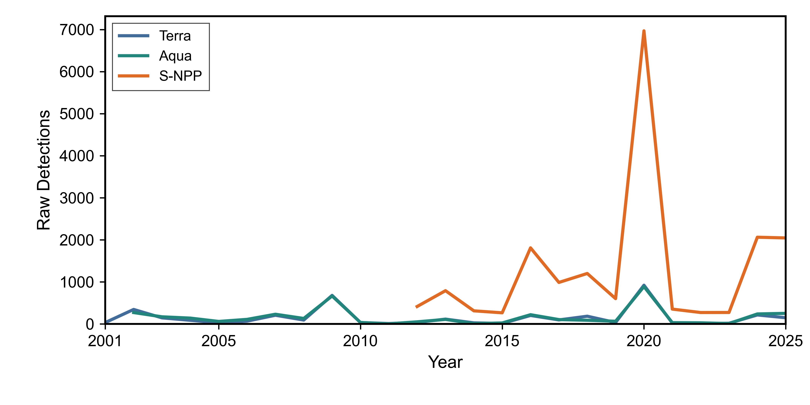

# FlareFront

**A 25-year satellite hotspot calendar for Los Angeles County, connecting monthly patterns with observed locations and sensor history.**

2001–2025 · 300 months · 26,113 qualifying observations · 39 source archives

## A longer view of reported fire activity

Explore a year-by-month calendar, select a month to inspect its county map and weekly totals, and compare the unadjusted Terra MODIS, Aqua MODIS, and Suomi-NPP VIIRS records. Date and source filters follow through to CSV downloads; chart controls export PNG and SVG figures. The static application bundles its data and browser libraries, with no API key or Python backend.


<table>
<tr>
<td width="50%"><br><sub>January 2025, split into Monday-start UTC weeks.</sub></td>
<td width="50%"><br><sub>Unadjusted sensor records; first sensor years may be partial.</sub></td>
</tr>
</table>

Calendar colors use log(1 + count), with the full-record range fixed for each series. Colorbar ticks, hover values, and CSV downloads retain detection counts; no values are clipped.

## What the calibration achieved

Terra MODIS supplies the reference counts. The main calendar uses Terra through 2012, then **α × Suomi-NPP** from 2013. The coefficient is fitted only on 2013–2019 totals: **α = 676 / 5,973 = 0.1131759585**. Evaluation uses all 72 months in the held-out 2020–2025 period.

| Series compared against Terra | Monthly mean absolute error |
| --- | ---: |
| **Adjusted Suomi-NPP** | **4.924891** |
| Unscaled Suomi-NPP | 147.805556 |
| Training-period seasonal median | 18.513889 |

The adjusted series passes the predefined aggregate criterion: lower MAE than both baselines on identical evaluation months. It does **not** improve on the seasonal baseline in every year: adjusted MAE is 2.364167 versus 1.166667 in 2022, and 2.009013 versus 1.500000 in 2023. Annual and processing-period comparisons remain visible in the dashboard.

## Interpret the record carefully

- These are **hotspot detections, not individual fires**, burned area, severity, forecasts, or emergency guidance. Multiple satellite reports can relate to one fire; fractional Terra-equivalent values are estimates.
- Zero means no qualifying detections were reported. Missing source periods remain unavailable. Point records do not establish observation coverage, cloud-free conditions, or absence of fire.
- The record is not verified as uniform Collection 6.1. Supplied MODIS labels `6.2`, `6.03`, and `61.03`, and VIIRS CSV version `2`, are preserved. A single ratio does not model all seasonal, diurnal, coverage, or processing differences.
- Aqua July 2002 and Suomi-NPP January 2012 are partial first months. Historical medians use the same month in all other available years, excluding the selected year; they are retrospective references.

Qualifying records fall inside or on the full Census 2026 county MultiPolygon, including offshore components, have type 0, and meet MODIS confidence ≥ 30 or VIIRS nominal/high confidence. Exact location/date/time/satellite duplicates are removed; distinct overpasses remain separate. All dates and aggregation use UTC.

## Run locally

Requires **Node.js 22+**. Data and browser dependencies are bundled; no package installation is required.

```sh
npm run build
npm start
```

Open the local address printed by the server. The build output is `dist/`.

For Cloudflare Pages, connect this GitHub repository, select the `main` branch, set the build command to `npm run build`, and set the output directory to `dist`. Set `NODE_VERSION=22` and `SKIP_DEPENDENCY_INSTALL=true` in the build environment; the static build requires no dependency installation. Hosting has not been deployed; there is no public website URL yet.

## Reproduce the analysis

Python is used for offline preprocessing, validation, and reference figures. Requires **Python 3.12+**, the pinned dependencies in [requirements.txt](requirements.txt), and the original NASA FIRMS annual ZIPs: `modis_2001_all_countries.zip` through `modis_2025_all_countries.zip`, plus `viirs-snpp_2012_all_countries.zip` through `viirs-snpp_2025_all_countries.zip`. Only each archive's `United_States` CSV member is read; originals are unchanged.

Windows PowerShell:

```powershell
python -m venv .venv
.venv\Scripts\python -m pip install -r requirements.txt
.venv\Scripts\python analysis/stage_firms.py --source-dir PATH_TO_ARCHIVES --sensor modis --start-year 2001 --end-year 2025 --output-dir build-data
.venv\Scripts\python analysis/stage_firms.py --source-dir PATH_TO_ARCHIVES --sensor viirs-snpp --start-year 2012 --end-year 2025 --output-dir build-data
Copy-Item web/data/county.geojson build-data/los_angeles_county_2026.geojson
.venv\Scripts\python analysis/build_data.py --input-dir build-data --output-dir web/data
npm run build
```

Replace `PATH_TO_ARCHIVES` with the folder containing those ZIPs. On macOS/Linux, use `.venv/bin/python` and `cp`. Filter definitions live in [analysis/config.json](analysis/config.json); the dashboard data preserves source-member names, CRC32 values, version counts, exclusion accounting, and computed metrics.

```powershell
npm test
.venv\Scripts\python -B -m unittest discover -s tests -p test_analysis.py -v
.venv\Scripts\python analysis/figures.py --data web/data/dashboard.json --output-dir web/figures
```

Validation completed: **15 Node tests and 11 Python tests passed**. Chromium checks covered desktop/mobile layouts, month and source selection, filtered CSV downloads, PNG/SVG exports, and unavailable-data states. Set `FLAREFRONT_INPUT_DIR` to the staging directory for the real-data acceptance case outside the original workspace. Reference figures are exported as matching 600 dpi PNG and vector SVG files; Arial Regular is required.

## Sources and license

[NASA FIRMS](https://firms.modaps.eosdis.nasa.gov/country/) supplies the MODIS and Suomi-NPP observations. The county geometry comes from [U.S. Census TIGERweb](https://tigerweb.geo.census.gov/arcgis/rest/services/TIGERweb/State_County/MapServer), using the same 2026 boundary for every year.

Original application and analysis code is licensed under [Apache-2.0](LICENSE). See [NOTICE](NOTICE) and [THIRD_PARTY_NOTICES](THIRD_PARTY_NOTICES) for attribution and third-party terms.

AI assisted code editor was used for code development
